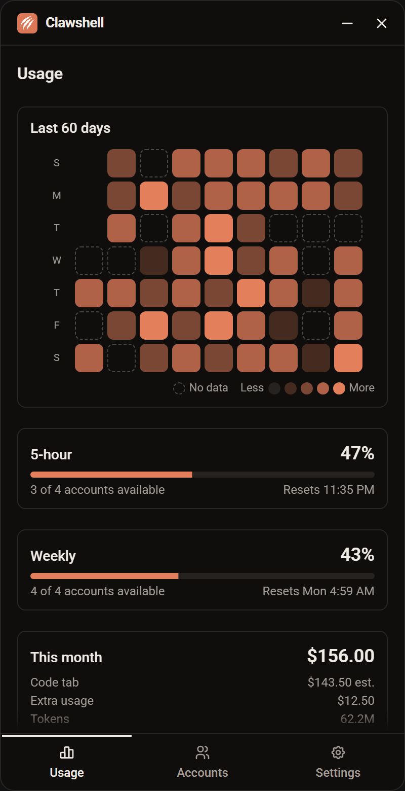
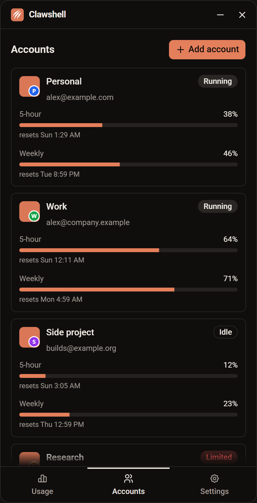
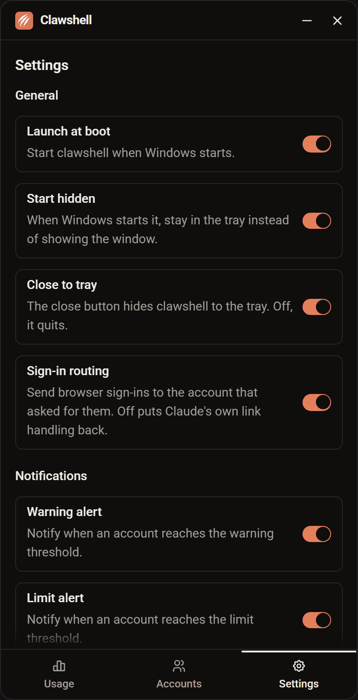

<p align="center">
  
</p>

<h1 align="center">clawshell</h1>

<p align="center">
  Run several Claude Desktop accounts side by side on Windows, and see how much of each one's limits you have left.
</p>

<p align="center">
  <a href="https://github.com/mehdikhody/clawshell/releases/latest"></a>
  
  
  <a href="LICENSE"></a>
</p>

<p align="center">
  <a href="https://github.com/mehdikhody/clawshell/releases/latest"></a>
</p>

---

clawshell is a small tray app for people with more than one Claude subscription. Each account runs in its own Claude Desktop window at the same time, so you never sign out to switch. A compact dashboard shows each account's remaining 5-hour and weekly capacity and what your Code-tab sessions cost.

> [!IMPORTANT]
> clawshell is an unofficial project and is not affiliated with Anthropic. See the [disclaimer](#disclaimer) before you use it.

## Contents

- [Features](#features)
- [Screenshots](#screenshots)
- [Requirements](#requirements)
- [Installation](#installation)
- [Usage](#usage)
- [How it works](#how-it-works)
- [Privacy](#privacy)
- [Development](#development)
- [Releasing](#releasing)
- [Credits](#credits)
- [Disclaimer](#disclaimer)
- [License](#license)

## Features

- **Concurrent accounts.** Every account gets an isolated Claude Desktop profile, so several can be open and signed in at once.
- **Limit tracking.** See the 5-hour and weekly usage of every account, how many accounts can still work, and when the next one resets.
- **Cost overview.** A monthly dollar total per account, combining real extra-usage spend with an estimate for Code-tab sessions priced from token counts.
- **60-day heatmap.** Daily cost or daily load at a glance.
- **Limit notifications.** Alerts when an account crosses thresholds you choose.
- **Windows integration.** Tray icon, a separate taskbar button per account with a coloured badge, desktop shortcuts, and launch at boot.
- **Sign-in routing.** Browser sign-ins return to the account that started them.
- **Per-account configuration.** Names, badge colours, environment variables and launch flags.
- **English and Persian.** Full right-to-left layout for Persian.

## Screenshots

|                                                                          Usage                                                                          |                                                                 Accounts                                                                  |                                                               Settings                                                               |
| :-----------------------------------------------------------------------------------------------------------------------------------------------------: | :---------------------------------------------------------------------------------------------------------------------------------------: | :----------------------------------------------------------------------------------------------------------------------------------: |
|  |  |  |
|                                                     Monthly cost, pooled capacity and daily history                                                     |                                                     Every account's status and limits                                                     |                                                  Startup, tray, routing and alerts                                                   |

<sub>Screenshots use sample data.</sub>

## Requirements

- Windows 10 or 11
- [Claude Desktop](https://claude.ai/download) installed
- One or more Claude accounts

## Installation

[](https://github.com/mehdikhody/clawshell/releases/latest)

1. Download the latest installer (`.exe` setup or `.msi`) from the [latest release](https://github.com/mehdikhody/clawshell/releases/latest).
2. Run it and follow the prompts.
3. Start clawshell. It finds `Claude.exe` automatically. If detection fails, set the path under **Settings**.

## Usage

The window is phone-sized (400×780) with three tabs along the bottom. clawshell lives in the system tray.

### Usage tab

Shows this month's dollar total across all accounts, split per account. Two bars show the average 5-hour and weekly capacity left across your signed-in accounts, how many accounts can still work, and when the next one resets. A heatmap of the last 60 days shows daily cost or daily load.

### Accounts tab

Lists each account with its name, email, 5-hour and weekly usage, and one of four statuses: **Running**, **Idle**, **Signed out** or **Limited**.

| Action               | How                                                                                                           |
| -------------------- | ------------------------------------------------------------------------------------------------------------- |
| Open an account      | Double-click it. If its window is already open, clawshell brings it forward.                                  |
| Add an account       | Click **Add**. clawshell creates a profile and opens Claude at the sign-in screen.                            |
| Configure an account | Rename it, change its badge colour, set environment variables and launch flags, or create a desktop shortcut. |
| Remove an account    | Delete it from the account's menu.                                                                            |

### Settings tab

| Setting         | Description                                                  |
| --------------- | ------------------------------------------------------------ |
| Launch at boot  | Start with Windows, either shown or hidden in the tray.      |
| Close to tray   | Keep running in the tray when the window is closed.          |
| Language        | English or Persian (right-to-left).                          |
| Sign-in routing | Send browser sign-ins back to the account that started them. |
| Notifications   | Alert when an account reaches the usage thresholds you set.  |
| Claude path     | A manual path to `Claude.exe` if automatic detection fails.  |

## How it works

### Isolated profiles

Claude Desktop is an Electron app, and Electron accepts `--user-data-dir`. clawshell gives every account its own folder, `%LOCALAPPDATA%\clawshell-{uuid}`, and launches Claude with it. Each folder holds its own cookies and sign-in, so the accounts run side by side. The folders sit directly under `%LOCALAPPDATA%` because Cowork's local VM only looks there. Your original Claude Desktop sign-in is never touched.

### Usage data

Usage numbers come from two undocumented Anthropic OAuth endpoints, one for the profile and one for usage. clawshell reads each account's token from its profile folder and keeps it in memory only. It never refreshes the token, because a refresh would rotate it under the running Claude and sign that window out. When a token has expired, clawshell marks the last values as stale and falls back to the usage history Claude Desktop keeps in each profile.

### Cost estimates

Cost comes from the transcripts Claude Code writes for Code-tab sessions. clawshell matches them to accounts by session id and prices the tokens with [LiteLLM's public price list](https://github.com/BerriAI/litellm). Regular claude.ai chats leave no token data on disk, so they aren't counted. clawshell keeps no history of its own, and Claude Code deletes transcripts after about 30 days by default, so older days in the heatmap may show no data.

## Privacy

- Tokens are read from local Claude Desktop profiles, held in memory, and never written elsewhere.
- Tokens are sent only to Anthropic's own endpoints.
- clawshell has no telemetry and no server of its own. The only other network request fetches LiteLLM's public price list.

## Development

### Prerequisites

- [Node.js](https://nodejs.org/) 22 or later
- [Rust](https://www.rust-lang.org/tools/install) (stable, with support for the 2024 edition)
- The [Tauri prerequisites for Windows](https://tauri.app/start/prerequisites/)

### Getting started

```powershell
git clone https://github.com/mehdikhody/clawshell.git
cd clawshell
npm install
npm run tauri dev
```

### Scripts

| Command               | Description                                         |
| --------------------- | --------------------------------------------------- |
| `npm run tauri dev`   | Run the app with hot reload                         |
| `npm run tauri build` | Build the Windows installers                        |
| `npm test`            | Run the Vitest suite once                           |
| `npm run check`       | Type-check with svelte-check                        |
| `npm run lint`        | Check formatting with Prettier and lint with ESLint |
| `npm run format`      | Format the codebase with Prettier                   |

### Tech stack

| Layer        | Technology                                                                                     |
| ------------ | ---------------------------------------------------------------------------------------------- |
| Shell        | [Tauri v2](https://tauri.app/) (Rust)                                                          |
| Frontend     | [SvelteKit](https://svelte.dev/docs/kit) with [Svelte 5](https://svelte.dev/)                  |
| Styling      | [Tailwind CSS 4](https://tailwindcss.com/) and [shadcn-svelte](https://www.shadcn-svelte.com/) |
| Localisation | [Paraglide](https://inlang.com/m/gerre34r/library-inlang-paraglideJs) (English and Persian)    |
| Testing      | [Vitest](https://vitest.dev/) with browser tests through Playwright                            |

### Project layout

```text
src/                SvelteKit frontend
  lib/              Usage, cost, heatmap and locale logic, with tests
  lib/screens/      The Usage, Accounts and Settings screens
messages/           Translation strings (en.json, fa.json)
src-tauri/          Rust backend: profiles, tray, taskbar, shortcuts, commands
.scratch/           Spec and tickets for v1
docs/agents/        Notes for coding agents on issues and labels
```

### Project docs

- `.scratch/clawshell-v1/spec.md` holds the full spec: user stories, implementation decisions and testing seams. Its Further Notes record the ticket 01 check, which confirmed that a token read from a Claude Desktop profile is accepted by both OAuth endpoints.
- `.scratch/clawshell-v1/issues/` holds the 15 v1 tickets, all resolved.

## Releasing

Releases are built by the [release workflow](.github/workflows/release.yml) on GitHub Actions.

1. Bump `version` in `src-tauri/tauri.conf.json`.
2. Commit the change.
3. Push a matching tag, for example `v0.1.0`:

   ```powershell
   git tag v0.1.0
   git push origin v0.1.0
   ```

The workflow fails if the tag and the version differ. Otherwise it runs the tests, builds the Windows installers and publishes them to a GitHub release.

## Credits

clawshell builds on the work of two MIT-licensed projects:

- [Claude-Code-Desktop-Switcher](https://github.com/PriyanshuGeTRekT/Claude-Code-Desktop-Switcher) worked out the profile folders, taskbar identity and sign-in routing for Claude Desktop.
- [claude-swap](https://github.com/realiti4/claude-swap) worked out the usage endpoint and its polling limits.

## Disclaimer

clawshell is unofficial and not affiliated with, endorsed by, or supported by Anthropic. It reads tokens that Claude Desktop stores on your machine and calls endpoints Anthropic doesn't document, which may change or break without notice. Anthropic's terms of service apply to using more than one account. You use clawshell at your own risk.

## License

Released under the [MIT License](LICENSE).
