<p align="center">
  
</p>

<h1 align="center">clawshell</h1>

<p align="center">
  Run several Claude Desktop accounts side by side on Windows, and see how much of each one's limits you have used.
</p>

<p align="center">
  <a href="https://github.com/mehdikhody/clawshell/releases/latest"></a>
  
  
  <a href="LICENSE"></a>
</p>

<p align="center">
  <a href="https://github.com/mehdikhody/clawshell/releases/latest"></a>
</p>

---

clawshell is a small tray app for people with more than one Claude subscription. Each account runs in its own Claude Desktop window at the same time, so you never sign out to switch. A compact dashboard shows how much of each account's 5-hour and weekly limits you have used, and what your Code-tab sessions cost.

> [!TIP]
> **New in this release:** Arabic, Russian and Chinese, a Calendar setting with Jalali, Hijri and Chinese lunar dates, copying Code sessions between accounts, and Quit Claude per account. See [What's new](docs/updates/v0.3.0.md).

> [!IMPORTANT]
> clawshell is an unofficial project and is not affiliated with Anthropic. See the [disclaimer](#disclaimer) before you use it.

## Contents

- [Features](#features)
- [Screenshots](#screenshots)
- [Requirements](#requirements)
- [Installation](#installation)
- [Updating](#updating)
- [Usage](#usage)
- [How it works](#how-it-works)
- [Privacy](#privacy)
- [Development](#development)
- [Releasing](#releasing)
- [Credits](#credits)
- [Disclaimer](#disclaimer)
- [License](#license)

## Features

- **Concurrent accounts.** Every account gets an isolated Claude Desktop profile, so several can be open and signed in at once.
- **Limit tracking.** See how much of each account's 5-hour and weekly limits is used, how many accounts can still work, and when the next one resets.
- **Cost overview.** A monthly dollar total per account, combining real extra-usage spend with an estimate for Code-tab sessions priced from token counts.
- **9-week heatmap.** Daily cost at a glance. Hover a day to see its dollars and tokens, split by account.
- **Limit and reset notifications.** Alerts when an account crosses thresholds you choose, and whenever a 5-hour or weekly window resets.
- **Your order.** Drag accounts to reorder them. The order carries over to the tray menu, the cost card and the heatmap.
- **Automatic updates.** clawshell checks GitHub releases, shows what's new, and installs the update in place.
- **Windows integration.** Tray icon, a separate taskbar button per account with a coloured badge, desktop shortcuts, and launch at boot.
- **Sign-in routing.** Browser sign-ins return to the account that started them, with a warning if Windows sends them elsewhere.
- **Per-account configuration.** Names, badge colours, environment variables and launch flags.
- **English, Persian, Arabic, Russian and Chinese.** Full right-to-left layout for Persian and Arabic, tooltips and menus included, and a Calendar setting with Jalali, Hijri and Chinese lunar options.

## Screenshots

|                                                                        Usage                                                                         |                                                                 Accounts                                                                  |                                                        Settings                                                        |
| :--------------------------------------------------------------------------------------------------------------------------------------------------: | :---------------------------------------------------------------------------------------------------------------------------------------: | :--------------------------------------------------------------------------------------------------------------------: |
|  |  |  |
|                                                     Daily history, pooled usage and monthly cost                                                     |                                                     Every account's status and limits                                                     |                                           Startup, tray and sign-in routing                                            |

### New in this release

|                                                                         Copy sessions                                                                         |                                                                               Account menu                                                                                |                                                                   Calendar                                                                   |
| :-----------------------------------------------------------------------------------------------------------------------------------------------------------: | :-----------------------------------------------------------------------------------------------------------------------------------------------------------------------: | :------------------------------------------------------------------------------------------------------------------------------------------: |
| 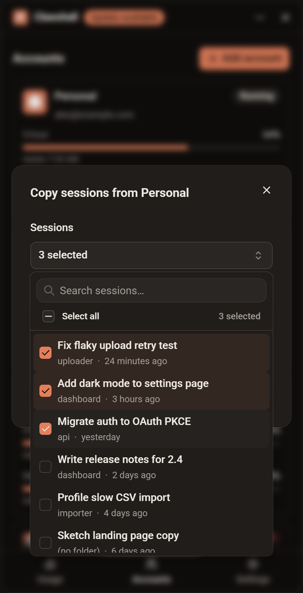 | 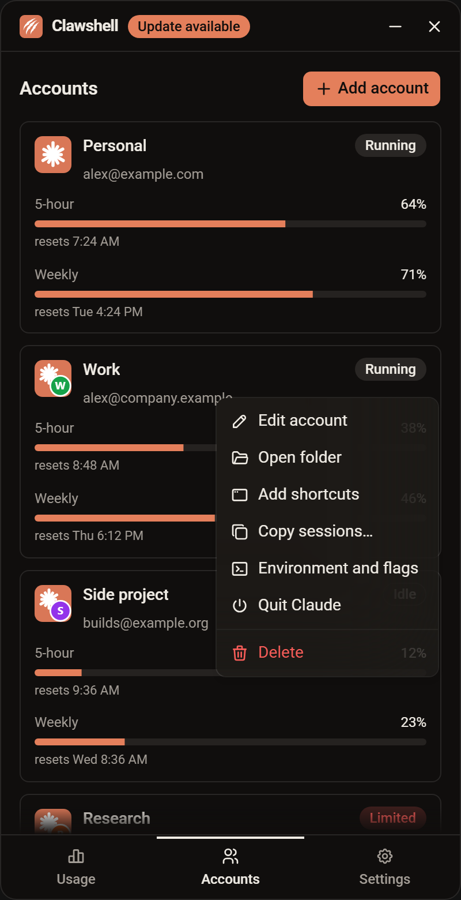 | 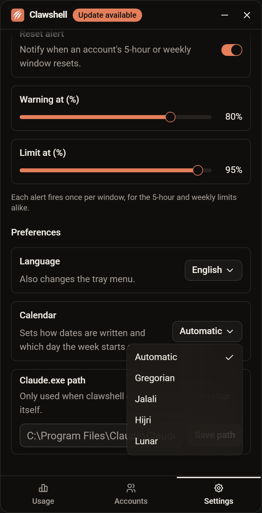 |
|                                                             Move Code sessions to another account                                                             |                                                                    Edit, copy sessions and quit Claude                                                                    |                                                      Gregorian, Jalali, Hijri or Lunar                                                       |

### Languages

|                                                                      Persian                                                                       |                                                          Arabic                                                           |                                                    Russian                                                    |                                            Chinese                                            |
| :------------------------------------------------------------------------------------------------------------------------------------------------: | :-----------------------------------------------------------------------------------------------------------------------: | :-----------------------------------------------------------------------------------------------------------: | :-------------------------------------------------------------------------------------------: |
| 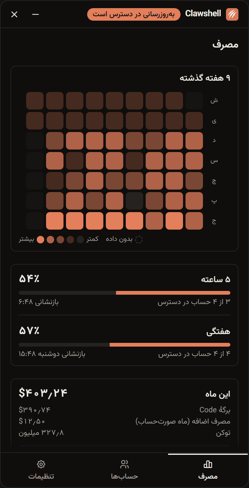 | 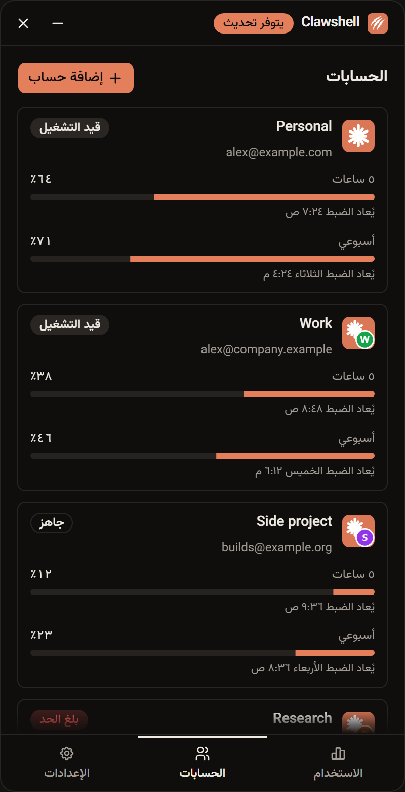 | 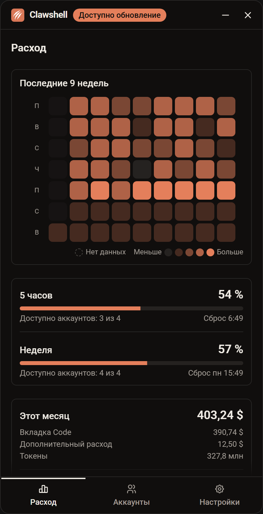 | 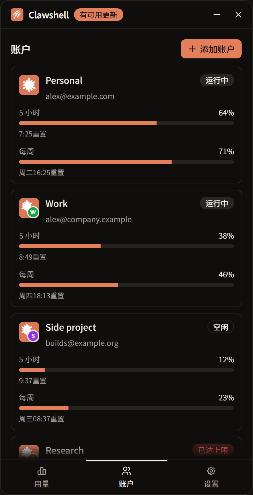 |
|                                                           Right to left, Jalali calendar                                                           |                                               Right to left, Hijri calendar                                               |                                               Weeks from Monday                                               |                                         Its own font                                          |

### More

|                                                                  Update dialog                                                                   |                                                                    Heatmap breakdown                                                                    |                                                                   Reset alerts                                                                   |                                                                            Sign-in warning                                                                            |
| :----------------------------------------------------------------------------------------------------------------------------------------------: | :-----------------------------------------------------------------------------------------------------------------------------------------------------: | :----------------------------------------------------------------------------------------------------------------------------------------------: | :-------------------------------------------------------------------------------------------------------------------------------------------------------------------: |
| 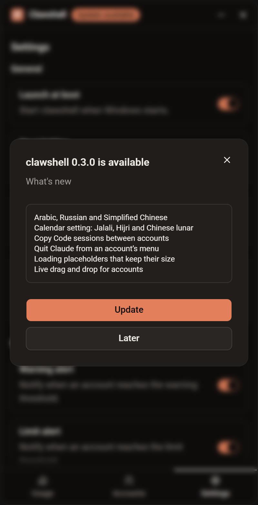 | 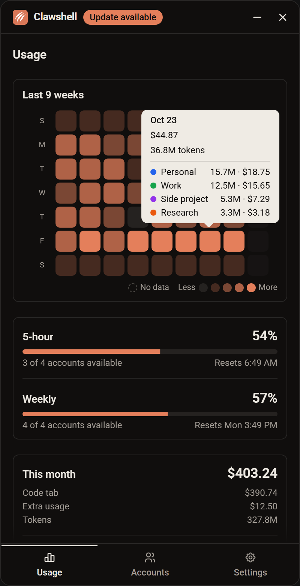 | 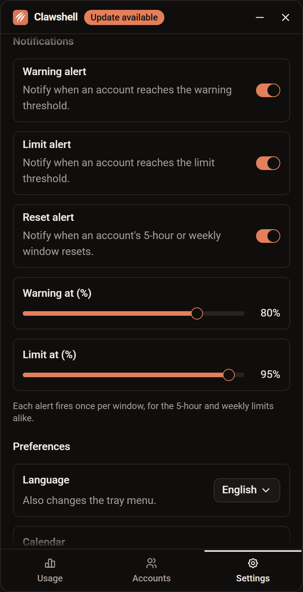 | 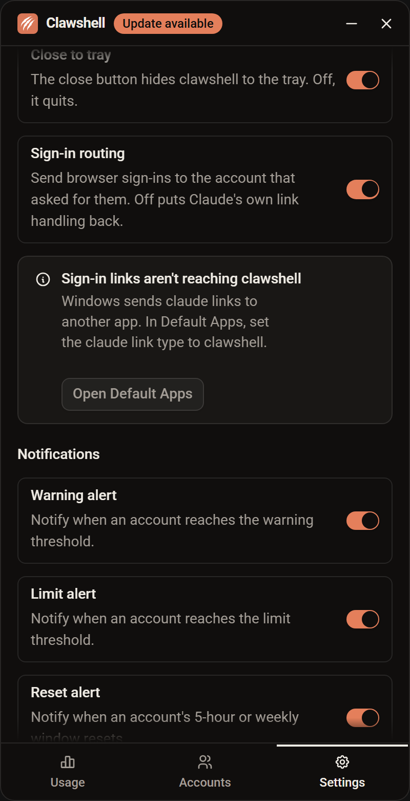 |
|                                                       Release notes, one click to install                                                        |                                                         A day's dollars and tokens per account                                                          |                                                         Warning, limit and reset alerts                                                          |                                                                 When Windows sends sign-ins elsewhere                                                                 |

<sub>Screenshots use sample data.</sub>

## Requirements

- Windows 10 or 11
- [Claude Desktop](https://claude.ai/download) installed
- One or more Claude accounts

## Installation

[](https://github.com/mehdikhody/clawshell/releases/latest)

1. Download the latest installer (`.exe` setup or `.msi`) from the [latest release](https://github.com/mehdikhody/clawshell/releases/latest).
2. Run it and follow the prompts.
3. Start clawshell. It finds `Claude.exe` automatically. If detection fails, set the path under **Settings**.

## Updating

clawshell checks the latest GitHub release when it starts and every 6 hours after that. When a newer version exists, an **Update available** badge appears next to the title. Click it to read the release notes, then choose **Update** to download and install it. clawshell restarts on the new version when the install finishes. If the download fails, your current version keeps running and the dialog offers **Retry**.

Only stable releases are offered. Every update is signed, and clawshell refuses one whose signature doesn't match.

> [!NOTE]
> v0.1.0 shipped without the updater. If you're on v0.1.0, install the latest release by hand once. From then on, clawshell updates itself.

## Usage

The window is phone-sized (400×780) with three tabs along the bottom. clawshell lives in the system tray.

### Usage tab

- **Last 9 weeks.** A heatmap of daily cost, nine full weeks from Sunday (Saturday in Persian). Days still to come this week are drawn as faint slots, and dashed cells mean no data. Hover or tap a day to see its dollars and tokens, then each account's share with its badge colour.
- **5-hour and weekly.** The average share of each limit used across your signed-in accounts, how many accounts can still work, and when the next one resets. The bars change colour at your warning and limit thresholds.
- **This month.** The dollar total across all accounts, split into Code-tab estimate and extra usage, with token counts and each account's share.

### Accounts tab

Lists each account with its badge, name, email, 5-hour and weekly usage, and one of four statuses: **Running**, **Idle**, **Signed out** or **Limited**.

| Action               | How                                                                                                                          |
| -------------------- | ---------------------------------------------------------------------------------------------------------------------------- |
| Open an account      | Double-click it. If its window is already open, clawshell brings it forward.                                                 |
| Add an account       | Click **Add account**, or choose **Add account** from the tray menu. clawshell creates a profile and opens Claude's sign-in. |
| Reorder accounts     | Drag a row up or down. The tray menu, cost card and heatmap follow the same order.                                           |
| Configure an account | Right-click it to rename it, change its badge colour, set launch options, add shortcuts or open its folder.                  |
| Remove an account    | Right-click it and choose **Delete**.                                                                                        |

### Settings tab

| Setting                  | Description                                                                                                  |
| ------------------------ | ------------------------------------------------------------------------------------------------------------ |
| Launch at boot           | Start clawshell when Windows starts.                                                                         |
| Start hidden             | When Windows starts it, stay in the tray instead of showing the window.                                      |
| Close to tray            | Keep running in the tray when the window is closed. Off, it quits.                                           |
| Sign-in routing          | Send browser sign-ins back to the account that started them.                                                 |
| Warning and limit alerts | Notify when an account reaches the warning or limit threshold you set.                                       |
| Reset alert              | Notify whenever an account's 5-hour or weekly window resets, whether or not it hit the limit.                |
| Language                 | English, Persian, Arabic, Russian or Chinese (Arabic and Persian right-to-left). Also changes the tray menu. |
| Calendar                 | Automatic, Gregorian, Jalali, Hijri or Chinese lunar. Decides how dates are written.                         |
| Claude.exe path          | A manual path to `Claude.exe` if automatic detection fails.                                                  |

If sign-in routing is on but Windows sends `claude://` links to another app, which happens with the Microsoft Store build of Claude, Settings shows a warning with an **Open Default Apps** button. Set the `claude` link type to clawshell there and the warning clears by itself.

## How it works

### Isolated profiles

Claude Desktop is an Electron app, and Electron accepts `--user-data-dir`. clawshell gives every account its own folder, `%LOCALAPPDATA%\clawshell-{uuid}`, and launches Claude with it. Each folder holds its own cookies and sign-in, so the accounts run side by side. The folders sit directly under `%LOCALAPPDATA%` because Cowork's local VM only looks there. Your original Claude Desktop sign-in is never touched.

### Usage data

Usage numbers come from two undocumented Anthropic OAuth endpoints, one for the profile and one for usage. clawshell reads each account's token from its profile folder and keeps it in memory only. It never refreshes the token, because a refresh would rotate it under the running Claude and sign that window out. When a token has expired, clawshell marks the last values as stale and falls back to the usage history Claude Desktop keeps in each profile.

### Cost estimates

Cost comes from the transcripts Claude Code writes for Code-tab sessions. clawshell matches them to accounts by session id and prices the tokens with [LiteLLM's public price list](https://github.com/BerriAI/litellm). Regular claude.ai chats leave no token data on disk, so they aren't counted. clawshell keeps no history of its own, and Claude Code deletes transcripts after about 30 days by default, so older days in the heatmap may show no data.

### Updates

clawshell uses the [Tauri updater](https://v2.tauri.app/plugin/updater/). It reads `latest.json` from the latest GitHub release, verifies the installer against the public key built into the app, and runs it in passive mode.

## Privacy

- Tokens are read from local Claude Desktop profiles, held in memory, and never written elsewhere.
- Tokens are sent only to Anthropic's own endpoints.
- clawshell has no telemetry and no server of its own. Besides Anthropic, it makes two kinds of request: one fetches LiteLLM's public price list, and the update check reads the latest release from GitHub.

## Development

### Prerequisites

- [Node.js](https://nodejs.org/) 22 or later
- [Rust](https://www.rust-lang.org/tools/install) (stable, with support for the 2024 edition)
- The [Tauri prerequisites for Windows](https://tauri.app/start/prerequisites/)

### Getting started

```powershell
git clone https://github.com/mehdikhody/clawshell.git
cd clawshell
npm install
npm run tauri dev
```

### Scripts

| Command                     | Description                                         |
| --------------------------- | --------------------------------------------------- |
| `npm run tauri dev`         | Run the app with hot reload                         |
| `npm run tauri build`       | Build the signed Windows installers (needs the key) |
| `npm run tauri:build:local` | Build the installers without the signing key        |
| `npm test`                  | Run the Vitest suite once                           |
| `npm run check`             | Type-check with svelte-check                        |
| `npm run lint`              | Check formatting with Prettier and lint with ESLint |
| `npm run format`            | Format the codebase with Prettier                   |
| `npm run screenshots`       | Retake the README screenshots with sample data      |

Release builds also create signed updater artifacts, and `tauri build` fails at the end if `TAURI_SIGNING_PRIVATE_KEY` is not set. For a local build, use `npm run tauri:build:local`. It turns updater artifacts off, so it needs no key.

### Tech stack

| Layer        | Technology                                                                                                            |
| ------------ | --------------------------------------------------------------------------------------------------------------------- |
| Shell        | [Tauri v2](https://tauri.app/) (Rust), with the updater and process plugins                                           |
| Frontend     | [SvelteKit](https://svelte.dev/docs/kit) with [Svelte 5](https://svelte.dev/)                                         |
| Styling      | [Tailwind CSS 4](https://tailwindcss.com/) and [shadcn-svelte](https://www.shadcn-svelte.com/)                        |
| Localisation | [Paraglide](https://inlang.com/m/gerre34r/library-inlang-paraglideJs) (English, Persian, Arabic, Russian and Chinese) |
| Testing      | [Vitest](https://vitest.dev/) with browser tests through Playwright                                                   |

### Project layout

```text
src/                SvelteKit frontend
  lib/              Usage, cost, heatmap, update and locale logic, with tests
  lib/components/   App shell, header, update badge and dialog, heatmap
  lib/screens/      The Usage, Accounts and Settings screens
messages/           Translation strings (en.json, fa.json)
src-tauri/          Rust backend: profiles, tray, taskbar, shortcuts, commands
scripts/screenshots/  Retakes the README screenshots against a sample-data backend
.scratch/           Specs and tickets (clawshell-v1, auto-update)
docs/screenshots/   README screenshots
docs/updates/       Release notes for each version
docs/agents/        Notes for coding agents on issues and labels
```

### Project docs

- `.scratch/clawshell-v1/spec.md` holds the v1 spec: user stories, implementation decisions and testing seams. Its 15 tickets in `.scratch/clawshell-v1/issues/` are all resolved.
- `.scratch/auto-update/spec.md` holds the auto-update spec and its tickets.
- `docs/updates/` holds the notes for each release.

## Releasing

Releases are built by the [release workflow](.github/workflows/release.yml) on GitHub Actions.

1. Bump `version` in `src-tauri/tauri.conf.json` and `package.json`.
2. Add the release notes to `docs/updates/`, as `v<version>.md`. The workflow fails if the file is missing and publishes it as the release body, which the in-app update dialog shows under **What's new**.
3. Run `npm run screenshots` to retake the README screenshots. It runs the frontend in headless Chromium against the sample data in `scripts/screenshots/mock.js` and writes to `docs/screenshots/`. Pass names, such as `npm run screenshots -- usage persian`, to retake only some.
4. Commit the changes.
5. Push a matching tag, for example `v0.2.0`:

   ```powershell
   git tag v0.2.0
   git push origin v0.2.0
   ```

The workflow fails if the tag and the version differ. Otherwise it runs the tests, builds the Windows installers, signs them for the updater and publishes them to a GitHub release together with `latest.json`. The workflow sets the release body from the notes file, dropping the screenshots and the **For maintainers** section. Installed copies of clawshell read `latest.json` from the latest stable release to find updates, so drafts and prereleases never reach users.

### Signing key setup

Updates are verified against a key pair. Set it up once before the first updater-enabled release:

1. Generate the key pair. Pick a password when prompted:

   ```powershell
   npx tauri signer generate -w ~/.tauri/clawshell.key
   ```

   This writes the private key to `~/.tauri/clawshell.key` and the public key to `~/.tauri/clawshell.key.pub`.

2. In the repository settings under **Secrets and variables > Actions**, add two secrets:
   - `TAURI_SIGNING_PRIVATE_KEY`: the contents of `~/.tauri/clawshell.key`.
   - `TAURI_SIGNING_PRIVATE_KEY_PASSWORD`: the password from step 1.
3. Put the contents of `~/.tauri/clawshell.key.pub` in `plugins.updater.pubkey` in `src-tauri/tauri.conf.json`, then commit it.
4. Back up the private key and its password somewhere outside the repository, such as a password manager. If you lose the key, installed copies cannot verify a new key and every user has to reinstall by hand.

Never commit the private key. Release builds fail early if `TAURI_SIGNING_PRIVATE_KEY` is missing or the updater public key isn't set.

## Credits

clawshell builds on the work of two MIT-licensed projects:

- [Claude-Code-Desktop-Switcher](https://github.com/PriyanshuGeTRekT/Claude-Code-Desktop-Switcher) worked out the profile folders, taskbar identity and sign-in routing for Claude Desktop.
- [claude-swap](https://github.com/realiti4/claude-swap) worked out the usage endpoint and its polling limits.

## Disclaimer

clawshell is unofficial and not affiliated with, endorsed by, or supported by Anthropic. It reads tokens that Claude Desktop stores on your machine and calls endpoints Anthropic doesn't document, which may change or break without notice. Anthropic's terms of service apply to using more than one account. You use clawshell at your own risk.

## License

Released under the [MIT License](LICENSE).
