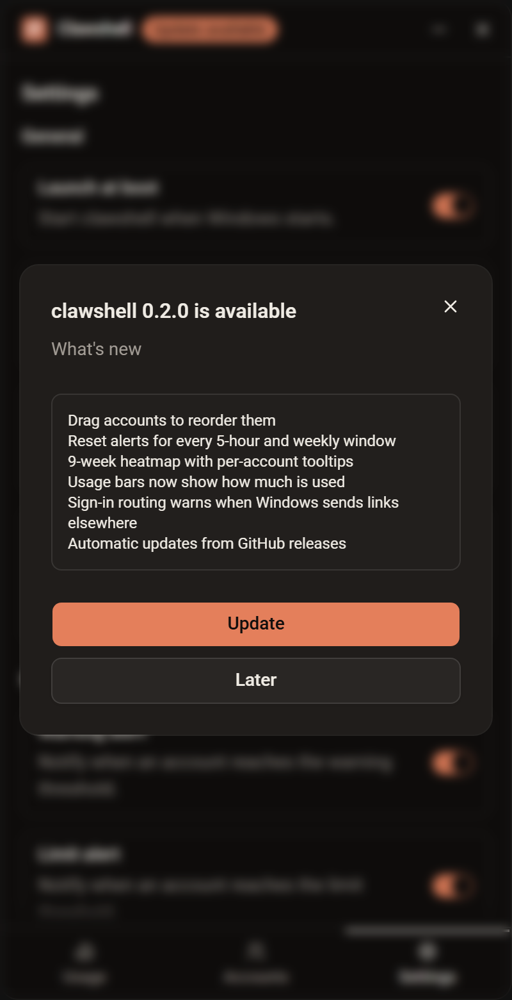
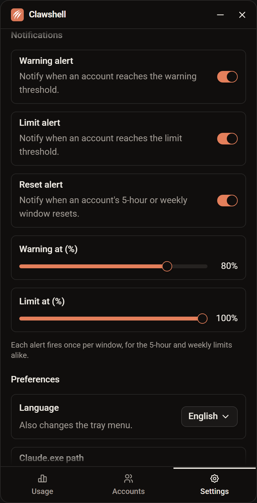
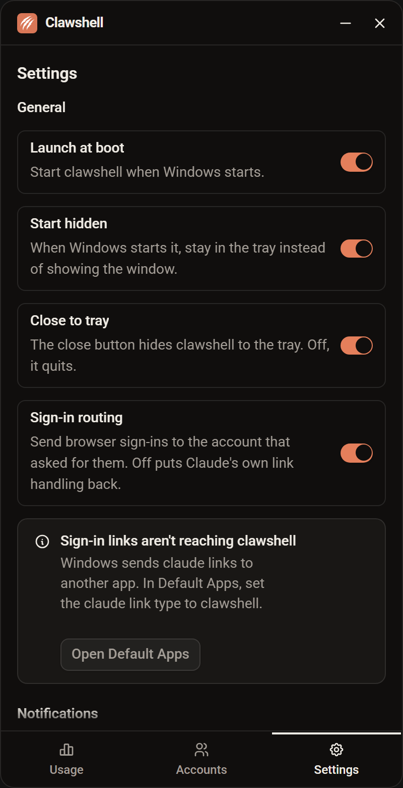
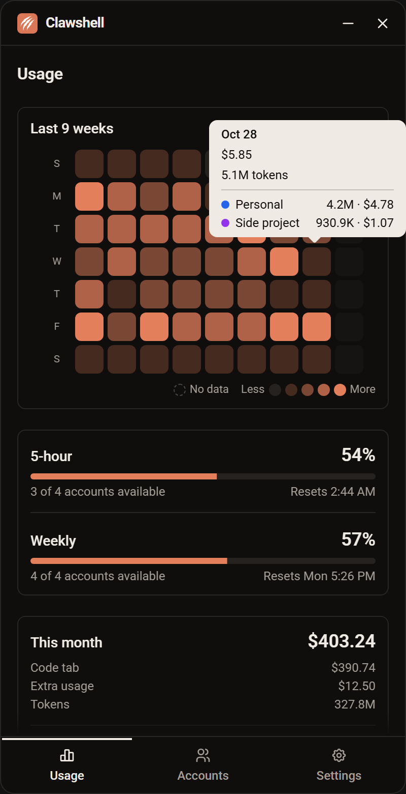

# clawshell v0.2.0

clawshell now updates itself, keeps your accounts in the order you choose, and tells you more about each day and each window.

> [!NOTE]
> v0.1.0 has no updater, so install v0.2.0 by hand from the [latest release](https://github.com/mehdikhody/clawshell/releases/latest). Every later version arrives in the app.

## New

### Automatic updates

clawshell checks GitHub for a new release when it starts and every 6 hours after that. When one is out, an **Update available** badge appears next to the title. Click it to read the release notes, then choose **Update**. clawshell downloads the installer with a progress bar, installs it and restarts. If the download fails, your current version keeps running and you can **Retry**.

Updates are signed, and clawshell only installs one whose signature matches the key built into the app. Drafts and prereleases are never offered.

### Drag accounts into your own order

Drag an account row up or down on the Accounts tab. The order is saved and used everywhere accounts are listed: the Accounts tab, the tray menu, the This month card and the heatmap tooltip. New accounts go to the end.

### Add an account from the tray

The tray menu has an **Add account** item. It brings the window forward on the Accounts tab with the Add dialog open.

### Alerts on every reset

The **Reset alert** used to fire only when a window that had hit its limit reset. It now fires whenever an account's 5-hour or weekly window resets, and says how much of the window was used. The first reading after clawshell starts stays silent, so you don't get a burst of alerts at launch.

### Warning when sign-in links go elsewhere

With the Microsoft Store build of Claude, or after you pick another app for `claude://` links in Default Apps, Windows ignores clawshell's link handler and sign-ins never reach it. Settings now shows a warning while that's the case, with an **Open Default Apps** button. Set the `claude` link type to clawshell there, and the warning clears by itself. Turning sign-in routing on opens Default Apps for you when it's needed.

## Changed

### A 9-week heatmap with a per-account breakdown

The heatmap is now always nine full weeks, starting on Sunday (Saturday in Persian), so it no longer spills past its card. Days still to come this week are drawn as faint slots. The title reads **Last 9 weeks**.

The tooltip shows the day's dollars and tokens in short form, such as `$12.3K` and `24.7M`, then lists each account's tokens and dollars with its badge colour. Accounts with no tokens that day are left out.

### Usage bars show what's used

The 5-hour and weekly bars on the Usage tab, and their percentages, now show how much of each limit is used rather than how much is left, matching the Accounts tab.

### Badge colours on the Usage tab

The This month card and the heatmap tooltip show each account's badge colour as a dot before its name, and the card spaces its accounts further apart.

## Fixed

- Tooltips are laid out right to left in Persian, like the menus.

## For maintainers

- Release builds create signed updater artifacts and upload `latest.json` with the installers. The workflow fails early if the signing key or the updater public key is missing.
- `npm run tauri:build:local` builds the installers without the signing key.
- See [Releasing](../../README.md#releasing) for the signing key setup.
