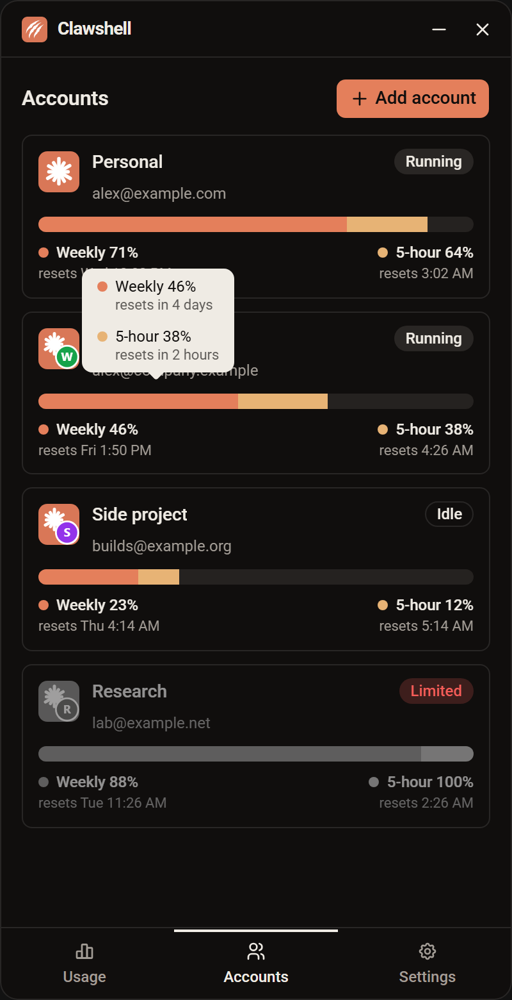
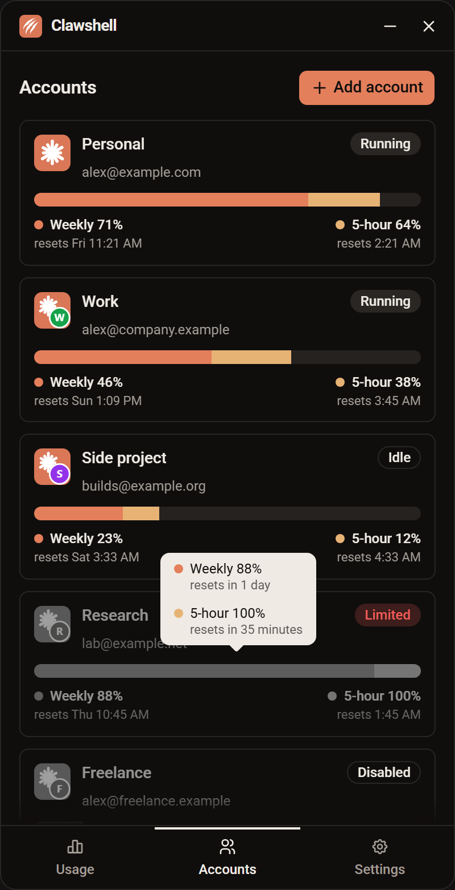

# clawshell v0.4.0

The Accounts screen shows each account's weekly and 5-hour usage on one bar, tells you when each window resets when you hover it, and fades out accounts you can't use right now.

## New

### One usage bar per account

Each account's weekly and 5-hour usage now share one thicker bar. The orange weekly segment is as wide as the weekly percentage. The amber 5-hour segment takes its percentage of the room the week leaves, so it shrinks as the week fills and has no room once the week is used up. Underneath, a coloured dot labels each window with its real percentage and reset time.

### Reset countdown on hover

Hover an account's usage bar to see both windows and how long until each resets, such as "resets in 2 days" or "resets in 45 minutes". The tooltip follows the pointer along the bar.

## Changed

- Limited accounts and accounts whose folder is missing look disabled: their icon, name, email and usage bar are greyed out and faded. Their badges and the Remove button keep their colour, and the row still opens Claude and its menu as before.
- The account usage bars keep their own colours and no longer turn orange or red at the warning and limit thresholds. The thresholds still decide when you are notified.
- The Accounts screen's loading placeholders look like the rows they stand in for.

