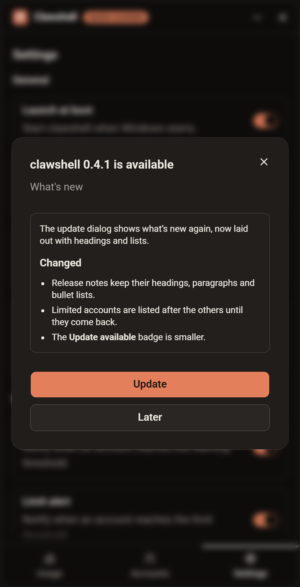

# clawshell v0.4.1

The update dialog shows what's new again, now laid out with headings and lists, and accounts you can't use right now move to the bottom of the list.

## Changed

- The update dialog lays out the release notes with their headings, paragraphs and bullet lists, instead of showing the raw `##` and `-` markers.
- Limited accounts and accounts whose folder is missing are listed after the others, on the Accounts screen and in the tray menu. They keep their place in your order and return to it once usable again. They can't be dragged, and other rows can't be dropped among them.
- The **Update available** badge in the title bar is smaller.
- The program file is now named `Clawshell.exe` instead of `clawshell.exe`.

## Fixed

- The update dialog's **What's new** was empty because the release notes never reached the update manifest. Releases now include them.
