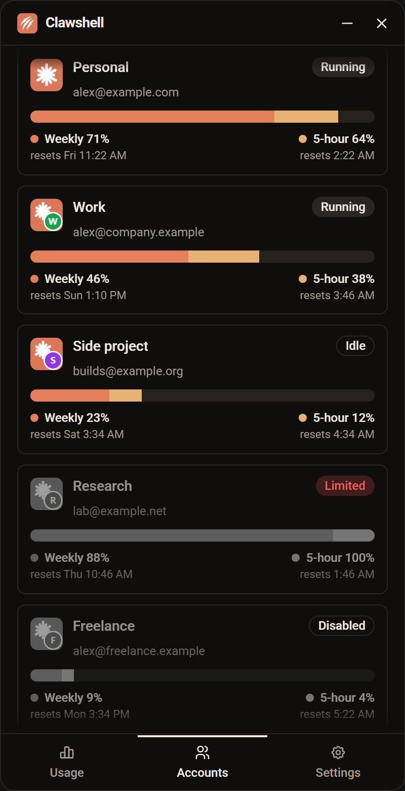

# clawshell v0.5.0

You can now disable an account you aren't using. It stays in clawshell, greyed out at the bottom of the list, until you enable it again.

## Added

- **Disable account** and **Enable account** in an account's right-click menu. A disabled account is greyed out, shows a **Disabled** badge (with **Running** beside it while its Claude is open), and is listed at the very bottom, below limited and missing accounts.
- A disabled account is hidden from the tray, left out of the pooled usage, can't receive copied sessions and sends no limit notifications. It still opens when you launch it, and disabling never closes a running Claude.
- Disabled accounts can be dragged among themselves, and each returns to its place in your order when enabled.

